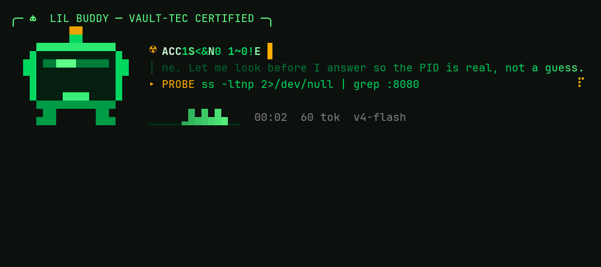

# Lil Buddy 🗄️

A Pip-Boy-flavored terminal sysadmin guru: zsh + pi + DeepSeek.

Type `lil how do I …` in zsh and get a punchy, styled answer from DeepSeek V4
Flash — with an interactive command scratchpad when the answer is a runnable
command. A reference guru for shells, CLIs, and *nix ops; not a coding agent.

## Features

- **One-shot answers** — `lil "…"` runs a quick [pi] session and prints a terse,
  ANSI-styled answer (inline code, bold/italic, headers, bullets, code blocks).
- **Command scratchpad** — when the answer ends in a `lilcmd` block, the command
  is offered in a framed box you can **run** (in this shell, history included),
  **copy**, or **dismiss** — then keep asking follow-ups in the same session.
- **Tag-tolerant extraction** — the wrapper accepts both fenced ```lilcmd blocks
  and `<lilcmd>` XML tags (belt and suspenders against model drift).
- **Terminal-aware** — a 24h fingerprint of your env (OS, shell, tmux, package
  manager, tool versions) is appended to every prompt, so answers match this
  machine's versions.
- **Context on demand** — clipboard and terminal scrollback are snapshotted at
  invocation and read by pi only if the question needs them.
- **Fully isolated** — its own `pi/` config dir (`PI_CODING_AGENT_DIR`); your
  main `~/.pi/agent` is never touched.



> Screenshot slot — drop a terminal capture of `lil` in action into
> `assets/screenshot.png` (the repo ships an empty `assets/` with `.gitkeep`).

## Requirements

- **macOS** (clipboard via `pbcopy`/`pbpaste`; `sw_vers` in the fingerprint)
- **zsh**
- **[pi coding agent] ≥ 0.82** ([earendil-works/pi](https://github.com/earendil-works/pi))
- **`DEEPSEEK_API_KEY`** environment variable (see your DeepSeek console)
- **A Nerd Font** for the glyphs (⌘, ⏎, ✏, ☢, ▸, ┃)
- **oh-my-zsh** optional — non-omz users add `source /path/to/lilbuddy/lil.zsh`
  to `.zshrc` manually

## Install

```sh
zsh /path/to/lilbuddy/install.zsh
```

This writes `source /path/to/lilbuddy/lil.zsh` to
`~/.oh-my-zsh/custom/lil.zsh` (auto-sourced on the next zsh start) and creates
`~/.cache/lil/`. It edits **no** other dotfiles. Open a new shell and you're
done:

```sh
lil "how do I find what's listening on port 8080"
```

## Usage

```sh
lil "<question>"          # ask; answer may come with a command scratchpad
```

A typical session:

```
╭─ 󰚩  LIL BUDDY ─ VAULT-TEC CERTIFIED ─╮
  `lsof -nP -iTCP:8080 -sTCP:LISTEN` shows open sockets on that port…
  ╔═ ☢  S C R A T C H P A D ═══════════════════════════╗
  ║ ❯ lsof -nP -iTCP:8080 -sTCP:LISTEN                ║
  ╚═══════════════════════════════ AWAITING ORDERS ═══╝
    [⏎ dismiss]  [^R ⌘⏎ RUN]  [^Y ⌘C copy]  [✏ type to reply]
```

While the scratchpad is open (stdin is a terminal):

| Key | Action |
|-----|--------|
| ⏎ / Esc / `q` `Q` | dismiss, back to zsh |
| ⌘Enter / Ctrl+R / `r` `R` | run the command in this shell (history included) |
| ⌘c / Ctrl+Y / `c` `C` `y` `Y` | copy the command to the clipboard |
| any other char | start a follow-up question in the same conversation |

Follow-up answers can hand over a new scratchpad command.

## How it works

```
lil "…"  (zsh function, current shell)
   │
   ├─ snapshot clipboard (pbpaste) + terminal scrollback (tmux capture-pane)
   ├─ regenerate ~/.cache/lil/fingerprint.txt (24h TTL)
   ├─ set WezTerm user-var LIL_SCRATCHPAD=1
   ├─ PI_CODING_AGENT_DIR=lilbuddy/pi pi -p -nc \
   │      --session ~/.cache/lil/session \
   │      --append-system-prompt "$(fingerprint)" "<question>"
   │        │  spinner owns the tty; stdout → temp file; 120s kill
   │        └─ pi → DeepSeek V4 Flash → SYSTEM.md persona (lilbuddy/pi/SYSTEM.md)
   │              tools read_clipboard / read_terminal read the snapshots
   ├─ render the answer (strip the lilcmd block, style the markdown)
   ├─ extract LAST lilcmd block (fence or <lilcmd> tag)
   ├─ scratchpad mode if a command, else follow-up mode
   │     ^R/^Y or typing → run / copy / re-ask pi (same session)
   └─ always → clear user-var LIL_SCRATCHPAD=0
```

Key design points:

- **Fingerprint** — env/versions cached 24h; appended to the persona so answers
  target *this* machine.
- **Snapshots** — clipboard and terminal are captured *before* pi starts, so the
  model sees your terminal, not pi's own output.
- **On-demand tools** — `read_clipboard`/`read_terminal` only read the snapshots
  when the question references them.
- **Isolation** — `PI_CODING_AGENT_DIR` points at this repo's `pi/` (its own
  `settings.json`, `models.json` — key via `$DEEPSEEK_API_KEY`, never a literal —
  and `SYSTEM.md` persona). Your `~/.pi/agent` is never touched.
- **Session-per-invocation** — each `lil` run starts a fresh pi session; the
  scratchpad follow-ups keep that same session alive.

## WezTerm / tmux enhancement (optional but nice)

The scratchpad reacts to plain Ctrl+R / Ctrl+Y. With WezTerm you can instead
press **⌘Enter** to run and **⌘c** to copy while the scratchpad is open.

1. Paste the two entries from `integrations/wezterm-lil.lua` into the `keys`
   table of your `wezterm.lua`.
2. Inside tmux, add `set -g allow-passthrough on` to `~/.tmux.conf` and
   `tmux source-file ~/.tmux.conf`.

When the scratchpad is closed, ⌘Enter stays fullscreen and ⌘c stays copy —
Lil Buddy only takes them over while it owns the prompt.

## Uninstall

```sh
rm ~/.oh-my-zsh/custom/lil.zsh
```

(Optionally remove `~/.cache/lil/` and `integrations/wezterm-lil.lua` entries
and the `allow-passthrough` line.)

## License

MIT — see [LICENSE](LICENSE).

[pi coding agent]: https://github.com/earendil-works/pi
